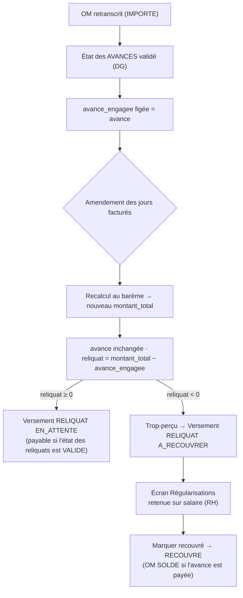

# Les deux circuits de validation — document de référence

> Pourquoi l'application a **deux** chemins vers le statut `VALIDE` d'un ordre de
> mission, quand chacun s'applique, et pourquoi ce n'est **pas** une double source
> de vérité. Ce document est la référence unique sur le sujet ; le code et les
> tests renvoient ici.
>
> *Relu le 27/10/2026 contre le code (version 1.4)* : notifications de chaque étape par droits
> effectifs (§1), quatre blocs de signature sur le PDF de l'OM, heure du Bénin et purge du cache
> des PDF à une mise à jour de version (§7). Références (§8) vérifiées une à une.

---

## 1. Les deux voies

| | Circuit par **ÉTAT** (canonique) | Circuit par **OM** (repli) |
|---|---|---|
| Service | `EtatPaiementService` | `MissionService` / `ValidationController` |
| Objet validé | l'**état de paiement** de la mission (document signé) | un **OM** isolé |
| Étapes | récap → `CONTROLE` → `VISA_DAF` → `VALIDE` (par tranche) | `IMPORTE` → `VALIDE` (**une seule étape**) |
| Effet sur les OM | la validation finale du DG **propage** `VALIDE` aux N OM ; un OM exonéré (montant nul) passe directement `SOLDE` | fait passer **l'OM** à `VALIDE` ; exonéré (montant nul) → `SOLDE` d'emblée |
| Quand | mission **avec** état de paiement (cas normal) | mission **sans** état (reprise de données, correction ponctuelle) |
| Interface | écrans *États de paiement* (récapitulatif, signatures, numéro) | boutons **Valider** (`om.valider`) / **Rejeter** (`om.rejeter`, motif ≥ 10 car.) sur la fiche OM, affichés seulement pour un OM `IMPORTE` d'une mission **sans** état |
| Rejet | rejet motivé de l'état à chaque étape (signatures amont effacées, paraphes archivés purgés) | `IMPORTE → REJETE` ; les versements `EN_ATTENTE` de l'OM passent `ANNULE` |
| Permissions | `om.retranscrire` (récapitulatif) · `om.valider` (contrôle) · `om.viser` (visa DAF) · `om.numeroter` (numéro) · `om.approuver` (validation DG) · `om.rejeter` | `om.valider` (contrôleur seul, matrice par défaut) · `om.rejeter` (contrôleur, DAF et DG) |
| Signatures sur le PDF de l'OM | celles de l'**état des avances** qui couvre l'OM (§7) | celle portée par l'OM |
| Notifications (comptes **actifs** détenant la permission, droits effectifs) | récapitulatif → `om.valider` ; contrôle → `om.viser` ; visa → `om.approuver` ; validation → `paiements.generer` ; rejet → `om.retranscrire` | validation → `paiements.generer` ; rejet → `om.retranscrire` |

Les notifications visent, depuis la 1.4 (décision D1), les comptes qui détiennent **effectivement** la
permission de l'étape suivante — rôles personnalisés et droits individuels compris, droits retirés
respectés, SUPER_ADMIN exclu (`NotificationService::notifier`). Avec la matrice par défaut, ce sont le
contrôleur, le DAF, le DG, l'agent financier et le gestionnaire OM, comme avant (détail :
`docs/workflows-par-profil.md` §8).

**Séparation des tâches** (`config/workflow.php` → `separation_des_taches`, activée par
défaut, `Workflow::separationDesTaches()`) : sur un même état, le DAF ne vise pas un état
qu'il a contrôlé, et le DG ne valide pas un état qu'il a contrôlé **ou** visé. La règle
vaut aussi pour le SUPER_ADMIN, qui détient pourtant toutes les permissions. Elle ne
concerne que le circuit par état : le circuit par OM n'a qu'une signature.

**Le circuit par ÉTAT est le circuit officiel de l'ANaTT.** Une seule signature sur
l'état (scellée HMAC, avec paraphe archivé et numéro de registre par tranche) vaut
pour tous ses bénéficiaires. C'est le document que le circuit Contrôleur → DAF → DG
valide, et c'est lui qui ouvre la génération des fichiers de paiement.

**Le circuit par OM est un repli.** Il existe pour les missions **sans** état :
données reprises d'avant l'introduction des états, ou correction unitaire d'un
import. Il n'a pas vocation à être utilisé quand un état existe.

---

## 2. L'invariant : exclusivité **par mission**

Les deux circuits ne tournent **jamais en parallèle sur une même mission**. Dès
qu'un état de paiement existe pour la mission, le circuit par OM est **fermé** :

```php
// MissionService::exigerAbsenceDEtat() — appelé par valider/rejeter
if ($etat !== null) {
    throw ValidationException::withMessages([
        'etat' => ["… l'action « {$action} » doit être effectuée sur l'état, pas sur l'OM."],
    ]);
}
```

Sans ce verrou, le statut d'un OM pourrait diverger de celui du document signé de
sa mission — le type de bug qui « passe les tests individuellement ». Le verrou
garantit qu'il n'existe **qu'une seule autorité** sur le statut d'un OM à un
instant donné :

- mission **avec** état → l'**état** fait foi ;
- mission **sans** état → l'**OM** fait foi.

Cet invariant est verrouillé par `tests/Feature/CoherenceCircuitsTest.php`.

**Un état rejeté ne rouvre pas le circuit par OM.** Le verrou regarde l'existence d'un
état, quel que soit son statut : un état `REJETE` ferme toujours le circuit par OM. On
reprend la main en établissant de nouveau le récapitulatif (`POST /api/missions/:id/etat/recapituler`),
qui ramène l'état rejeté en `BROUILLON` sur les montants courants, puis en refaisant
le circuit.

**Un rejet par OM n'est jamais défait par l'état.** Un OM rejeté sur le circuit par OM
**avant** que la mission ait un état reste `REJETE` : quand l'état des avances est ensuite
établi puis validé, la propagation (`EtatPaiementService::propager`) ne touche que les OM
qui ne sont ni `SOLDE`, ni `ANNULE`, ni `REJETE`. Sans cette exclusion, un OM rejeté
redevenait `VALIDE`, donc payable, alors qu'il est absent de l'état signé (défaut corrigé
par la revue d'octobre 2026, `docs/revue-projet-2026-10.md` §3 n° 1). Ses versements,
passés `ANNULE` au rejet, restent de toute façon hors des fichiers.

---

## 3. La porte de paiement est déjà unifiée

Quel que soit le circuit, l'éligibilité d'un versement à un fichier passe par le
**même** filtre, `Versement::scopeEligiblesLot()` :

> un versement est éligible si son OM est `VALIDE` **ET**
> (la mission n'a **aucun** état **OU** l'état **de sa tranche** est `VALIDE`).

Le même filtre écarte aussi, quel que soit le circuit :

- les versements déjà `CONFIRME`, `ANNULE` (OM rejeté) ou en régularisation
  (`A_RECOUVRER` / `RECOUVRE`) ;
- les montants **≤ 0** (reliquat de trop-perçu) ;
- tout versement porté par un lot **`CONFIRME`** : un lot confirmé n'est jamais réécrit,
  et un versement devenu payable après coup part dans un **lot complémentaire**
  (`lots_paiement.sequence` 2, 3…). L'écran de génération le propose (« Générer le lot
  complémentaire ») dès que l'aperçu liste un tel versement. Il ne bloque la génération que
  si rien n'est payable (défaut n° 21 de la revue : avant, il la bloquait dès que le dernier
  lot était confirmé).

Conséquences :

- `VALIDE` a le **même sens** dans les deux circuits : l'OM est verrouillé et
  payable. `scopeEligiblesLot` n'a donc jamais à distinguer par quel circuit un
  OM est arrivé à `VALIDE`.
- Verrou **par tranche** : valider les **avances** n'ouvre **pas** les reliquats.
- **Solde** : un OM passe `SOLDE` dès que tous ses versements sont **réglés** — payés
  (`CONFIRME`) ou, pour un trop-perçu, récupérés par retenue (`RECOUVRE`) —, quel que soit le
  circuit (`OrdreMission::solderSiRegle`). Le contrôle a lieu à la confirmation d'un lot, au
  constat d'un recouvrement **et** après un amendement qui ramène le reliquat à 0 (défaut n° 26) : avant le 23/10, un OM au trop-perçu recouvré restait
  `VALIDE` pour toujours (défaut n° 23). Un versement de montant nul (tranche vide, part d'avance
  à 0 ou 100 %) n'entre dans aucun fichier et ne retient pas l'OM (défaut n° 19). Un trop-perçu
  encore `A_RECOUVRER` le retient.
- **OM exonéré** (prise en charge par un tiers : montants nuls, aucun versement) : il est soldé
  dès sa validation, dans les deux circuits — par `EtatPaiementService::propager` sur le circuit
  par état, par `MissionService::valider` sur le circuit par OM (défaut n° 24 : il restait
  `VALIDE` sur ce dernier).
- Seconde barrière (défense en profondeur) : même si un OM est forcé à `VALIDE`
  hors circuit, aucun fichier n'est écrit tant que l'état de la tranche n'est pas
  validé (`FileGenerator::exigerEtatValide`, appelée avant toute écriture) — couvert par
  `tests/Feature/Paiement/BarriereEtatTest.php`.

---

## 4. Le circuit par OM tient en une seule étape

Le circuit par OM ne connaît qu'une transition : `IMPORTE → VALIDE` (le contrôleur
valide directement, permission `om.valider`), plus un rejet motivé depuis `IMPORTE`.
Il n'y a **pas** d'étapes DAF/DG par OM : la validation à trois signatures
(contrôle → visa DAF → validation DG) se joue **uniquement sur l'état** de la
mission (`EtatPaiementService`).

> Historique : un mode « double validation par OM » a existé (drapeau
> `workflow.double_validation`, statuts OM `VERIFIE` / `VISA_DAF`). Il était
> désactivé par défaut, dépourvu d'interface, et redondant avec le circuit par
> état — il a été retiré. Les valeurs d'enum `VERIFIE` / `VISA_DAF` restent
> acceptées en base pour d'éventuelles données héritées, mais ne sont plus
> produites. Seule `separation_des_taches` subsiste dans `config/workflow.php`
> (appliquée au circuit par état).

---

## 5. Pourquoi ne pas « fusionner » les deux circuits

Supprimer le circuit par OM pour tout faire passer par un état **casserait la
mémoire métier** :

1. **Reprise de données** : les missions importées/validées **avant** la feature
   « état » n'ont pas d'état ; elles deviendraient impossibles à valider ou
   rejeter.
2. **L'état est le document légal** (scellé HMAC par tranche, `lignes` figées,
   paraphes archivés, numéro de registre) — il ne peut être ni « fusionné dans
   l'OM » ni retiré.
3. **Migrations destructives** : l'enum `OrdreMission.statut` (`VERIFIE`,
   `VISA_DAF`), les colonnes de signature OM et le scellé HMAC au niveau OM
   disparaîtraient sur des données de production.

La position retenue : **conserver les deux circuits**, garantir leur exclusivité
par le verrou `exigerAbsenceDEtat` et l'unification à la porte de paiement, et
documenter ici quand chacun s'applique. Le repli par OM pourra être retiré le jour
où plus aucune mission sans état ne subsiste (fin de la reprise de données).

---

## 6. L'amendement d'un OM (avenant) après paiement de l'avance

Quand l'avance a déjà été payée, un OM peut voir ses **jours facturés** changer
(rallonge ou réduction). L'avance est alors **engagée** : elle ne se recalcule
plus. C'est le **reliquat** qui absorbe tout l'écart — quitte à devenir **négatif**
(trop-perçu). Cf. `docs/amendement-om.md` pour le détail métier.

Le point charnière est le **gel de l'avance**, posé par l'un ou l'autre circuit :

- **circuit par état** : à la validation finale de l'état des **avances**, chaque OM
  mémorise son avance dans `avance_engagee` (`EtatPaiementService::propager`) ;
- **circuit par OM** (mission sans état) : il n'y a pas de validation d'état pour figer
  l'avance ; c'est l'**amendement** lui-même qui l'engage si l'avance a déjà été payée
  (versement AVANCE `CONFIRME`), dans `MissionService::amender`. Sans cela, l'amendement
  recalculait la répartition complète en ignorant l'avance décaissée (défaut corrigé par
  la revue d'octobre 2026, §3 n° 3).

À partir de là, `reliquat = montant_total − avance_engagee`. Tant qu'aucune avance n'est
engagée, la répartition est recalculée en entier avec la part d'avance paramétrée
(`Parametres::partAvance()`, 70 % par défaut).



**Quand l'amendement est-il permis ?** (`MissionService::exigerAmendementPossible`)

| État de la mission | Amendement |
|---|---|
| Un versement de l'OM est `GENERE` (fichier en attente de dépôt) | ⛔ confirmez le lot ou passez-le en `ERREUR` d'abord (l'échec définitif d'une génération en file fait de même, `backend/docs/queues.md`) |
| Aucun état et avance non payée, ou état des avances `BROUILLON` | ✅ recalcul complet avec la part d'avance (rien n'est figé) |
| Aucun état et avance déjà `CONFIRME` (circuit par OM) | ✅ avance engagée à l'amendement, seul le reliquat bouge |
| État des avances `VALIDE` | ✅ avance figée, seul le reliquat bouge |
| État des avances `CONTROLE` / `VISA_DAF` | ⛔ rejetez-le d'abord (document en cours de signature) |
| État des reliquats `CONTROLE` / `VISA_DAF` | ⛔ **rejet guidé** : rejetez-le, amendez, puis rétablissez-le |
| État des reliquats `VALIDE` (scellé HMAC) | ⛔ avenant formel — hors périmètre v1 |
| Trop-perçu de l'OM déjà `RECOUVRE` (retenue soldée) | ⛔ avenant formel — hors périmètre v1 |
| Aucun état et reliquat déjà `CONFIRME` (circuit par OM) | ⛔ avenant formel — hors périmètre v1 (défaut n° 22) |
| OM `SOLDE` sans reliquat payé ni trop-perçu recouvré (avance à 100 % payée, reliquat ramené à 0) | ✅ l'OM redevient `VALIDE` si un montant est à régler, reste `SOLDE` sinon (défauts n° 25 et 28) |
| Trop-perçu de l'OM encore `A_RECOUVRER` (non retenu) | ✅ amendable (rien n'a été retenu) |
| OM `REJETE` / `ANNULE` | ⛔ |

**Intégrité garantie :**

- l'amendement verrouille l'OM puis les états de la mission (`lockForUpdate`) : un
  contrôle concurrent ne peut pas signer l'état entre la garde et la resynchronisation ;
- un état des reliquats en `BROUILLON` (ou `REJETE`) est **resynchronisé
  automatiquement** sur les montants amendés (`OrdreMissionObserver` →
  `EtatPaiementService::synchroniser`). Son total est le montant **payable** : la somme
  des reliquats **positifs** (`EtatPaiementService::montantsTranche`). Un trop-perçu
  n'abaisse jamais le total signé ; le PDF le mentionne à part (« hors total, à recouvrer
  par retenue sur salaire ») ;
- un état **signé** (`CONTROLE` / `VISA_DAF` / `VALIDE`) n'est **jamais** altéré
  par un amendement ; l'état des **avances validé reste scellé** (HMAC), ses
  montants ne bougeant pas (l'avance est figée) ;
- un reliquat négatif **ne part jamais** dans un fichier de paiement
  (`Versement::scopeEligiblesLot` exclut les montants ≤ 0 et les statuts
  `A_RECOUVRER` / `RECOUVRE`) : il relève d'une **régularisation** manuelle.

Le trop-perçu se récupère **hors Mobile Money** : l'application produit la trace
(écran Régularisations, statut `A_RECOUVRER`) et constate le recouvrement
(`RECOUVRE`) une fois la retenue appliquée par la RH — elle ne réalise pas la
retenue.

---

## 7. Les signatures sur le PDF de l'OM

Le PDF d'un OM (`GET /api/ordres/:id/pdf`) porte quatre blocs de signature, en deux rangées :
le bénéficiaire (nom imprimé, signature manuscrite hors application), puis les trois étapes du
circuit — contrôle, visa DAF (« Vu »), validation DG. Sous le circuit par état, l'OM lui-même n'est jamais signé ;
sans précaution, ces cases restaient « en attente » alors que l'état de la mission était
validé (défaut corrigé par la revue d'octobre 2026, §3 n° 11). Le PDF reprend donc les
signatures de l'**état des avances** qui couvre l'OM (`PdfGenerator::etatSignataire`) :

| Situation | Signatures affichées |
|---|---|
| OM signé lui-même (circuit par OM, données héritées) | celles de l'OM — **prioritaires** |
| État des avances `CONTROLE` / `VISA_DAF` / `VALIDE` et OM présent dans ses `lignes` | celles de l'état, étape par étape : même instantané du signataire, même paraphe archivé, même code de vérification que le PDF de l'état |
| OM absent des `lignes` figées de l'état (le récapitulatif écarte les OM `REJETE` / `ANNULE`) | aucune : l'état signé ne le couvre pas |
| OM `REJETE` / `ANNULE`, état `REJETE` ou `BROUILLON`, aucun état | aucune |
| PDF brouillon (`/pdf/brouillon`, filigrané) | aucune |

Chaque bloc signé imprime le nom, la date et l'heure (« Le JJ/MM/AAAA à HH:MM », à l'heure du
Bénin depuis la 1.4) et le code de vérification de l'étape.

Seul l'état des **avances** est repris : c'est sa validation qui fait passer l'OM à
`VALIDE`. L'état des reliquats ne change pas le statut de l'OM et n'apparaît pas sur son
PDF.

Le PDF est mis en cache sous `ordres/OM-{ref}-{statut}[-ETAT-{statut_etat}][-AMD{n}].pdf` : chaque
signature de l'état et chaque amendement de l'OM changent la clé, donc le PDF est régénéré sans
purge manuelle (`docs/amendement-om.md` §4.6). La clé ne porte pas la **version** de
l'application : quand une mise à jour change ce que le PDF imprime (gabarit en 1.3, heure du Bénin
en 1.4), le dossier `storage/app/private/ordres/` se vide à la main au déploiement, sans quoi un PDF
resté en cache n'afficherait pas les mêmes heures de signature que le PDF de l'état, toujours
régénéré (`docs/runbook-mise-a-jour-cron.md`, étape 6). Tests : `tests/Feature/OmPdfSignaturesEtatTest.php`,
`tests/Feature/OmPdfAmendementTest.php`.

---

## 8. Références

| Sujet | Emplacement |
|---|---|
| Circuit par état | `app/Services/EtatPaiementService.php` |
| Circuit par OM | `app/Services/MissionService.php`, `app/Http/Controllers/Api/ValidationController.php` |
| Règles de statut / séparation des tâches | `app/Support/Workflow.php`, `config/workflow.php` |
| Exclusivité (verrou) | `MissionService::exigerAbsenceDEtat()` |
| Propagation (exclut `SOLDE` / `ANNULE` / `REJETE`) | `EtatPaiementService::propager()` |
| Porte de paiement unifiée | `Versement::scopeEligiblesLot()`, `FileGenerator::exigerEtatValide()` |
| Signatures de l'état sur le PDF de l'OM | `PdfGenerator::etatSignataire()`, `PdfGenerator::signatureEtat()` |
| Notifications de chaque étape (droits effectifs) | `NotificationService::notifier()` ; tests `tests/Feature/NotificationTest.php` |
| Endpoints et permission de chaque transition | `backend/docs/openapi.yaml` (tags *États de paiement* et *Validation OM*, extension `x-permission`) |
| Interface du circuit par OM | `frontend/src/views/missions/MissionDetailView.vue` (Valider / Rejeter) |
| Solde d'un OM, lot complémentaire | `LotPaiementService::confirmer()`, `LotPaiementService::marquerRecouvre()`, `MissionService::amender()` (règle commune `OrdreMission::solderSiRegle()`), `MissionService::valider()` (exonéré), `frontend/src/components/paiements/PaiementGeneration.vue` ; tests `tests/Feature/SoldeTest.php`, `tests/Feature/RegularisationTest.php`, `tests/Feature/CircuitValidationTest.php`, `frontend/src/__tests__/paiements-async.spec.ts` |
| Amendement (avenant) & régularisations | `MissionService::amender()`, `MissionService::exigerAmendementPossible()`, `LotPaiementService::regularisations()`, `docs/amendement-om.md` |
| Document de retenue (PDF pour la RH) | `PdfGenerator::genererDocumentRetenue()`, `GET /api/paiements/regularisations/:versement/document` |
| Tests — exclusivité & sens de VALIDE | `tests/Feature/CoherenceCircuitsTest.php` |
| Tests — barrière de paiement | `tests/Feature/Paiement/BarriereEtatTest.php` |
| Tests — circuit OM (une étape, exonéré soldé) | `tests/Feature/CircuitValidationTest.php` |
| Tests — séparation des tâches | `tests/Feature/SeparationTachesTest.php` |
| Tests — signatures de l'état sur le PDF de l'OM | `tests/Feature/OmPdfSignaturesEtatTest.php` |
| Tests — amendement & intégrité de l'état | `tests/Feature/AmendementOmTest.php`, `tests/Feature/AmendementIntegriteEtatTest.php` |
| Tests — trop-perçus / régularisations (solde après recouvrement) | `tests/Feature/RegularisationTest.php` |
| Tests — avance engagée | `tests/Feature/AvanceEngageeTest.php` (circuit par état), `tests/Feature/AmendementOmTest.php` (circuit par OM) |
| Tests — OM rejeté jamais repêché, versements annulés | `tests/Feature/EtatPaiementTest.php`, `tests/Feature/MissionTest.php` |
| Revue d'octobre 2026 (défauts corrigés sur ces circuits) | `docs/revue-projet-2026-10.md` |
